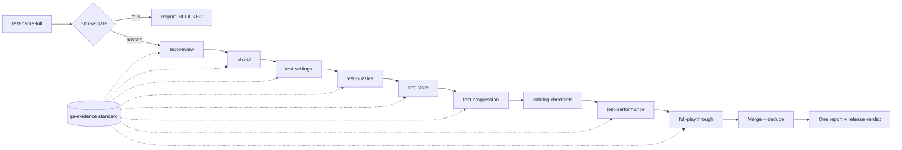

# Game QA Skills for Claude Code

Engine-agnostic game testing skills for [Claude Code](https://claude.com/claude-code). Each one turns the agent into a careful game tester. It finds the problems **and proves them** with screenshots, state reads, logs and `file:line` references, then writes a report a developer or producer can act on.

Unity, Godot, Unreal, web, desktop or mobile: the skills only need a playable build, the source, or both.


*A real report produced by `text-review` on my game [Pixel Swarm](https://github.com/heloisatorres1/pixel-swarm). [Read it](examples/pixel-swarm-text-review/report.md).*

## Why I built this

I've led game QA teams for 6+ years. AI agents can now play and inspect games, but an agent that says "I tested the store, it works" is no use to a team. These skills hold the agent to the same rules I hold human testers to:

- **No finding without proof.** Every bug has repro steps, expected vs actual, and evidence that opens in the report.
- **Reproduce before reporting.** A runtime bug is only `confirmed` after 2 reproductions from a clean state. Seen once? It's an `observation`.
- **Honest coverage.** Every area ends as `PASS`, `FAIL`, `PARTIAL`, `BLOCKED` or `NOT_TESTED`, with a reason. Things an AI can't judge (fun, audio quality, real devices) are listed as manual, not hidden.
- **Facts apart from guesses.** `actual` is what was seen. Root-cause ideas go in `suspected_cause`, worded as hypotheses.

The report builder enforces these rules: it refuses a `findings.json` with a "confirmed" bug seen once, a FAIL with no linked bug, or evidence files that don't exist.

## The skills

| Skill | What it does |
|---|---|
| [`text-review`](skills/text-review/SKILL.md) | Pulls every player-facing string from any engine (HTML, JSON, CSV/PO/XLIFF tables, Android/iOS strings, Godot scenes, Unity YAML, string literals in code), checks spelling, grammar, terms, placeholders and plurals, then screenshots the text in the running game to catch overlap and truncation. |
| [`full-playthrough`](skills/full-playthrough/SKILL.md) | Finishes the whole game: every level, theme, mode and ending. It builds a content inventory from the game data first, so locked or hidden content is not missed. It checks rewards and unlocks along the way, keeps a progress log it can resume from, and labels anything finished with cheats as `assisted`. |
| [`test-game-full`](skills/test-game-full/SKILL.md) | The test lead. Detects which features the game has, writes a test plan, runs a smoke gate, then runs the matching feature skills and merges their results into one report with a release verdict. |
| [`test-store`](skills/test-store/SKILL.md) | Prices vs data, currency deltas, insufficient funds, double purchase, restore, no-ads, rewarded ads, economy sources and sinks. Never spends real money. |
| [`test-puzzles`](skills/test-puzzles/SKILL.md) | Models the rules from the code, checks every level's data for solvability, then tries to break win/lose conditions and mechanics in the game. Every bug comes with a move trace. |
| [`test-progression`](skills/test-progression/SKILL.md) | Save/load, corrupted saves, unlock boundaries, XP, daily rewards, quests, achievements, events, clock and timezone changes. |
| [`test-ui`](skills/test-ui/SKILL.md) | Screen map, navigation and back behaviour, popup stacking, and layout on 7 screen sizes from small phone to ultrawide. |
| [`test-settings`](skills/test-settings/SKILL.md) | Every option: default, effect, persistence, reset. Audio is checked through real gain values. |
| [`test-performance`](skills/test-performance/SKILL.md) | Boot and load times, frame time and 1% lows, memory over long sessions, throttled runs. Every number is measured against a budget, with 3 runs and the raw data. |
| [`qa-evidence`](skills/qa-evidence/SKILL.md) | The shared standard all skills follow: how to reach the game, how to capture proof, statuses, severities and the `findings.json` format. Tools: the report builder (it enforces the rules), a Playwright harness that records **video without ffmpeg** and saves results crash-safe, and an evidence pruner. |

The full list of features `test-game-full` can cover, and how far an AI agent can go with each, is in the [feature catalog](skills/test-game-full/references/feature-catalog.md).

### How they fit together



Each skill also works on its own. Start with `text-review`: it's the quickest to try.

## Example: full QA pass on Pixel Swarm

I ran `test-game-full` on my own game, [Pixel Swarm](https://github.com/heloisatorres1/pixel-swarm). Results are in [`examples/pixel-swarm-full`](examples/pixel-swarm-full), with the [merged report](examples/pixel-swarm-full/report.md) and the [test plan](examples/pixel-swarm-full/test-plan.md):

- **80 scripted checks in 8 modules**: smoke gate, UI at 6 screen sizes, settings, puzzles (all 102 levels verified solvable, all 10 mechanics won in the real game), store, progression and daily rewards, tutorial / ads / lifecycle / accessibility, and performance.
- **7 bugs found and proven**, each reproduced at least twice, with video, screenshots, before/after save data and the line of code involved. Among them:
  - The **Level Complete popup closes on a tap outside it**: the coin reward is lost and the player is left on an empty board (4/4, video).
  - On **360 px phones the top bar pushes Settings and the store's Close button off screen** (15 balance cases × 2 runs).
  - The store **keeps selling the $4.99 offer that includes No Ads to players who own No Ads** (2/2, video).
- **Script mistakes are caught, not reported.** Six automated "failures" turned out to be problems in my own test scripts. They are listed in the test plan, not filed as bugs.
- [`scripts/`](examples/pixel-swarm-full/scripts) holds every Playwright script, so each result can be reproduced with one command.

## Example: Pixel Swarm text review

I ran `text-review` on my own web game, [Pixel Swarm](https://github.com/heloisatorres1/pixel-swarm). Results are in [`examples/pixel-swarm-text-review`](examples/pixel-swarm-text-review):

- **861 strings** extracted with `file:line`. No spelling or grammar errors.
- The numbers in the copy were checked against live game data ("Collect all 102 pictures" = 5 themes × 3 difficulties × 6 levels + 12 event levels).
- **6 text findings and 3 queries.** Two of them only show up in the running game: the tutorial's step dots are drawn over the ad banner text (reproduced 3/3), and a store subtitle is cramped on phone widths.
- [`terms.md`](examples/pixel-swarm-text-review/terms.md) is a term sheet the team can adopt as a style guide.
- [`scripts/session.mjs`](examples/pixel-swarm-text-review/scripts/session.mjs) is the Playwright script that captured the evidence, so anyone can run it again.


## Install

In Claude Code:

```
/plugin marketplace add heloisatorres1/game-qa-skills
/plugin install game-qa-skills@game-qa-skills
```

Or copy any folder from `skills/` into your project's `.claude/skills/` (or `~/.claude/skills/` for all projects). Keep `qa-evidence` next to the others, because they all use it.

**Requirements:** Node.js 18+ for the helper scripts (no npm packages needed). For web games, `playwright-core` goes in the run folder, never in your game project. It drives the Edge or Chrome you already have, so no browser download is needed.

## Use

Ask in plain language, or call a skill by name (installed as a plugin, the names get a prefix: `/game-qa-skills:text-review`):

```
/text-review ./my-game
Proofread all the player-facing text in this project and show me proof in the running build at http://localhost:8080
/test-store
Run a full QA pass on the build in ./Builds/WebGL, standard depth
/full-playthrough https://mygame.itch.io  scope: main path
```

Every run writes to `qa-reports/<date>-<skill>/`:

```
findings.json   # source of truth (schema: skills/qa-evidence/references/findings-schema.md)
evidence/       # screenshots, crops, state dumps, logs, save diffs
report.md       # paste into Jira, GitHub or Slack
report.html     # self-contained page (use --embed to inline the images)
```

You can also build a report from any `findings.json` yourself:

```bash
node skills/qa-evidence/scripts/build-report.mjs qa-reports/<run>/findings.json [--embed]
```

## Limits

These skills make an agent a disciplined tester. They do not replace one. An agent can't judge fun, game feel, audio quality, haptics or real-device performance, and it can't run real-money purchases or platform certification. The reports list these as manual checks, so a human tester knows exactly what's left.

## Repository layout

```
.claude-plugin/        plugin + marketplace manifests
skills/<name>/         SKILL.md, references/, scripts/
examples/              real runs with evidence and reports
docs/                  images for this README
```

## About

Made by **Heloisa Oller Torres**, QA Test Lead / Senior QA for games and software · [LinkedIn](https://www.linkedin.com/in/heloisa-torres-94250814a) · [GitHub](https://github.com/heloisatorres1)

Licensed under [MIT](LICENSE).
