# QA Report: Pixel Swarm

**Verdict: FAIL**

smoke: Gate passed: a clean install reaches the age gate in 3.5 s, the first launch flow (age gate, story, welcome, tutorial level) works, and all 10 main-menu buttons open something. One trivial issue: no favicon, so every load logs a 404. text-review: The copy is clean: no spelling or grammar errors in 861 strings, and the numbers in the text match the game data. The issues are consistency ('bees' vs 'bugs', 'in line' vs 'in the line') and two in-context layout problems seen only in the running game: tutorial dots drawn over the ad banner text and a cramped No Ads subtitle. Three queries ask whether demo wording and placeholder legal links are intended for the public build. test-ui: Tablet and desktop layouts are clean. On phones the top bar is too wide: at 360 px the Settings gear and the store's close X are cut or pushed off screen, completely from 9,999 coins. In phone landscape (web only; the Android app is portrait-locked) the Levels/Play block covers the Activities and Events buttons. test-settings: All 7 checks pass. The switches apply at once, survive a reload and the UI always matches the saved value. 'Sounds off' is proven by the audio engine: 0 effects played while tapping blocks, against 4 with sounds on. test-puzzles: All 102 levels are solvable and every mechanic was won in the real game by playing its solution. The fail flow works. One minor bug: Add Slot from the Out of Slots popup has no maximum, so repeated fails grow the board to 10+ squeezed slots, past the 7 the Add Slot booster allows. test-store: Prices, deltas, refusals and limits are correct in 13 of 15 checks. One major bug: once No Ads is owned, the store keeps selling the $4.99 Special Offer that includes No Ads. A double tap buys two coin packs (query). test-progression: Progression and daily systems are solid: rewards, unlock boundaries, the 7-day calendar, tasks and backup-save recovery all pass. One major bug: the Level Complete popup can be dismissed by tapping outside it or pressing Escape, which skips the coin reward and leaves the player on an empty board. catalog: Tutorial, simulated ads and save-on-close all work. Several buttons are smaller than the 44 px touch-target guideline (top-bar currency buttons, store Buy buttons, in-level Pause and Speed). test-performance: All budgets met on the test machine: boot 3.1 s (2.5 s of it is the designed loading screen), 1% low 90-119 fps, 58 fps at 4x CPU throttle, 1-3 hitches per minute, heap growth 0.95 MB/min (just under the 1 MB/min budget; worth a 10-minute run on a phone).

| | |
|---|---|
| Skill | test-game-full |
| Build | v1.0.0 debug build (commit db96df5) |
| Platform | Web, Microsoft Edge (Chromium, headless), 390x844 @2x touch \| Web, Microsoft Edge (Chromium), mobile viewport 390x844 @2x, plus 360x740 \| Web, Microsoft Edge (Chromium, headless): 360x640, 390x844, 844x390, 820x1180 (touch) and 1280x720, 1920x1080 (desktop) \| Web, Microsoft Edge (Chromium, headless, not capped at 60 Hz), 390x844 @2x, WebGL 2, test machine only |
| Access | Playwright (scripts/smoke.mjs), clean browser profile \| Source scan (extract-strings.mjs, 861 strings) + Playwright session against the local build (scripts/session.mjs) \| Playwright (scripts/ui.mjs): 10 screens x 6 sizes with an automatic layout probe (sideways scroll, elements off screen, clipped text, covered buttons) + manual review of every flag \| Playwright (scripts/settings.mjs) + save reads + the audio engine's own counters (PSAudio.debug) \| Playwright (scripts/puzzles.mjs, verify.mjs) + level tables read from the page + the game's solution verifier and solution bot (assisted) \| Playwright (scripts/store.mjs) + save reads from localStorage. Real-money items use the build's test purchases; no real payment exists. \| Playwright (scripts/progression.mjs) + save reads from localStorage; levels won by the game's auto-solve bot at 5x (assisted) \| Playwright (scripts/catalog.mjs) + save reads; the 2nd win for the ad check was triggered with the debug 'Win level' (assisted) \| Playwright (scripts/perf.mjs) running the game's own autoplay benchmark (#perfbench_N), with no other browsers running |
| Date | 2026-11-16 |
| Tester | Claude (AI-assisted QA) |
| Scope | smoke, text-review, test-ui, test-settings, test-puzzles, test-store, test-progression, catalog, test-performance |

**Confirmed:** 0 blocker · 0 critical · 3 major · 6 minor · 5 trivial

## Coverage

| Area | Status | Checks | Findings | Notes |
|---|---|---|---|---|
| smoke / Smoke gate | PASS | 5/5 |  | SM-01 boot 3548 ms; SM-02 first launch; SM-03 0 script errors; SM-04 Play / Pause > Exit; SM-05 10 menu buttons. |
| text-review / Spelling and grammar (all sources) | PASS | 861/861 |  | 861 candidate strings reviewed; 0 spelling or grammar errors. US spelling used consistently (color, armor, honorable). |
| text-review / Terminology and consistency | FAIL |  | TXT-001, TXT-004, TXT-005, TXT-006, QRY-001 |  |
| text-review / Numbers in text vs game data | PASS | 4/4 |  | 'Collect all 102 pictures' = 5 themes x 3 difficulties x 6 + 12 event levels; '12 spooky pictures' = 12; '6 bugs, 7 looks each' matches the skin table; '7 days in a row' matches DAILY_REWARDS (7 entries). |
| text-review / First launch (age gate, story, welcome) | PASS |  |  |  |
| text-review / Text in context (layout, overlap, truncation) | FAIL |  | TXT-002, TXT-003 |  |
| text-review / Store and monetisation copy | PARTIAL |  | QRY-002, QRY-003 | Copy is correct; two queries about demo wording and placeholder legal links. Store screens checked at 390 and 360 px only. |
| text-review / Text inside images | NOT_TESTED |  |  | Sprite and background art were not inspected for baked-in text. |
| text-review / Android notification delivery | NOT_TESTED |  |  | Notification strings were reviewed in source (js/native.js); seeing them on a device needs the Android build. |
| test-ui / Screen map (10 screens x 6 sizes) | PASS |  |  | Contact sheets per size in evidence. |
| test-ui / Phone portrait (360, 390, 412 px) | FAIL |  | BUG-002 |  |
| test-ui / Phone landscape (web) | FAIL |  | BUG-005 |  |
| test-ui / Tablet and desktop | PASS |  |  | Probe flags reviewed by hand and rejected as expected behaviour: lower queue blocks sit behind the booster bar by design (only the front row is tappable); skin and store buttons scrolled under the bottom navigation are inside a scroll area. |
| test-ui / Popup dismiss rules | FAIL |  | BUG-001 | Locked: age gate, Out of Slots, welcome. Dismissible by tap outside/Escape: 12 others, including Level Complete (BUG-001, filed by test-progression). |
| test-settings / Switches (music, sounds, haptics, notifications) | PASS | 3/3 |  | Defaults on; each switch turns off in UI and save; still off after reload. |
| test-settings / Audio effect of the switches | PASS | 2/2 |  | Measured through the audio engine, not by ear: sounds off = 0 effects, on = 4 effects for the same taps. Mix and loudness need a human ear. |
| test-settings / Player ID, version, Copy | PASS | 2/2 |  |  |
| test-settings / Haptics and notifications on a device | NOT_TESTED |  |  | The switches were tested; vibration and real notifications need the Android build on a phone. |
| test-puzzles / Level data | PASS | 2/2 |  | 15 tables of 6 + 12 event levels; every picture exists; no picture used twice. |
| test-puzzles / Solvability (all levels) | PASS |  |  | LEVEL CHECK 102/102 from the game's own solution verifier (#verify_all, 334 s), no unsolvable forced-puzzle variants. Assisted: relies on the game's verifier. |
| test-puzzles / Puzzle mechanics in the real game | PASS | 10/10 |  | mystery, frozen, hidden, linked, big, pipe, key, wood, cookie, mystery links: each level won by the solution bot at 8x (36-58 s), no script errors. Assisted. |
| test-puzzles / Fail flow | PASS | 3/3 |  | Out of Slots cannot be dismissed by Escape/tap outside; Try Again restarts; Give Up returns without reward. The fail popup was opened with the debug 'Lose level' (assisted). |
| test-puzzles / Slot limits | FAIL |  | BUG-004 |  |
| test-store / Catalogue purchases and balances | PASS | 5/5 |  | Gem packs S/L, coin pack S (enough and exact balance), coin pack L refused with 100/250 gems. Balances re-read after reload. |
| test-store / Ownership (No Ads, Special Offer) | FAIL | 1/3 | BUG-003 | No Ads itself works (Owned, no banner in levels, survives reload). |
| test-store / Edge cases | PARTIAL |  | QRY-101, TXT-101 | Double tap on a coin pack buys two packs (query, by design?). |
| test-store / Free Coins (rewarded ads) | PASS |  |  | 5 ads per day at +100; the button is disabled after the 5th; '0 left today' shown. |
| test-store / Bug skins | PASS | 3/3 |  | Ladybug bought and equipped (200 -> 50 gems); Beetle refused with 100 gems; Firefly locked below player level 5. |
| test-store / Speed Store | PASS | 2/2 |  | +5 min for 250 coins and 3x for 100 gems; 30 min refused with 50 coins. |
| test-store / Real in-app purchases and ad SDK | NOT_TESTED |  |  | The build has test purchases and simulated ads only; store sandbox testing needs the Android build and a test account. |
| test-progression / Win flow and rewards | FAIL | 1/5 | BUG-001 | PR-W1 (Continue pays +30 and opens Level 2) passes; PR-W2 runs 1-4 reproduce BUG-001. |
| test-progression / Persistence | PASS |  |  | Stars and coins survive reload (PR-W1); purchases survive closing the tab (catalog CT-LIFE-1). |
| test-progression / Difficulty unlocks | PASS | 2/2 |  | Medium locked at 5/6 Easy, unlocked at 6/6. |
| test-progression / Daily rewards | PASS | 5/5 |  | Day 1 +500 coins; same-day claim refused after reload; streak continues; missed days reset; Day 7 chest then back to Day 1. |
| test-progression / Daily tasks | PASS |  |  | Unfinished task disabled; finished task pays +150 once even when double-tapped. |
| test-progression / Corrupted saves | PASS | 2/2 |  | Broken main slot: backup loaded (4,321 coins). Both slots broken: fresh start at the age gate, no errors. |
| test-progression / Time handling | PARTIAL |  |  | Day changes were simulated by moving the last-claim date in the save. Changing the device clock or time zone was not tested (a frozen browser clock stalls the loading screen, which is a test-tool limit, not a game bug). |
| catalog / Tutorial | PASS | 2/2 |  | All 6 steps completed, including the 'tap this block' step; not shown again afterwards. |
| catalog / Ads (simulated) | PASS | 3/3 |  | Video ad after every 2nd win without No Ads, none with No Ads; rewarded AD slot gives +1 slot only after the ad. |
| catalog / Lifecycle | PASS |  |  | A purchase is still there after closing the tab immediately (saved at once). |
| catalog / Accessibility: touch targets | FAIL |  | BUG-006 |  |
| catalog / Notifications | NOT_TESTED |  |  | Android-only (Capacitor Local Notifications); needs a device. |
| catalog / Colour and contrast | NOT_TESTED |  |  | Not measured in this run. The game already enforces a minimum colour distance between puzzle colours in data.js (MIN_DE). |
| test-performance / Boot | PASS |  |  | 3096 / 3096 / 3101 ms to the main menu; the loading screen has a ~2.5 s minimum by design. |
| test-performance / Frame rate during play | PASS | 2/3 |  | Budget: 1% low >= 45 fps, <= 2 hitches/min, in at least 2 of 3 runs. Run 1 had 3 hitches/min (2 long tasks), runs 2-3 had 1/min. Averages of ~143 fps reflect the uncapped headless browser. |
| test-performance / Slow device (4x CPU throttle) | PASS |  |  | 1% low 58.2 fps, 2 hitches/min. |
| test-performance / Memory over a long session | PASS |  |  | Heap 8.3 -> 13.2 MB in 200 s (0.95 MB/min, budget 1); DOM stable (-0.4 nodes/min); scene objects +30/min. Close to the budget: repeat with the game's 10-minute benchmark on a real phone. |
| test-performance / Target devices | NOT_TESTED |  |  | Real phones (low-end Android, iPhone) need a manual run; numbers here come from a desktop machine. |

## Findings

| ID | Severity | Type | Status | Title |
|---|---|---|---|---|
| BUG-001 | major | bug | confirmed | Level Complete popup closes on a tap outside it or Escape: the coin reward is never paid and the player is left on an empty board |
| BUG-002 | major | bug | confirmed | Top bar overflows on 360-390 px phones: the Settings gear (menu) and the Close X (store) are cut or pushed off screen, completely from 9,999 coins |
| BUG-003 | major | bug | confirmed | Store keeps selling the $4.99 Special Offer, which includes No Ads, to players who already own No Ads |
| BUG-004 | minor | bug | confirmed | Add Slot from the Out of Slots popup has no maximum: repeated fails grow the board to 10 squeezed slots (the booster stops at 7) |
| BUG-005 | minor | bug | confirmed | Phone landscape (web): the Levels / Play block covers the Activities and Events buttons on the main menu |
| BUG-006 | minor | bug | confirmed | Several buttons are below the 44 px touch-target guideline on phones (top-bar currency buttons, store Buy, in-level Pause and Speed) |
| BUG-007 | trivial | bug | confirmed | No favicon: every page load logs a 404 error in the console |
| TXT-001 | minor | text | confirmed | The swarm is called 'bees' in some texts and 'bugs' in others, even in two consecutive How to Play cards |
| TXT-002 | minor | text | confirmed | Tutorial step dots are drawn on top of the ad banner text at the bottom of the game screen |
| TXT-003 | minor | text | confirmed | Store: the No Ads subtitle is cramped and leaves 'ads' alone on a second line on phone widths |
| TXT-004 | trivial | text | confirmed | Booster descriptions say 'in line' where How to Play says 'in the line', and describe Shuffle differently |
| TXT-005 | trivial | text | confirmed | 'Out of Slots' is capitalised mid-sentence in How to Play but lowercase in the tutorial |
| TXT-006 | trivial | text | confirmed | Two ellipsis styles: 'Loading...' (three dots) vs 'Sending…' and 'Taking a screenshot…' |
| TXT-101 | trivial | text | confirmed | Special Offer toast says '+10K coins' while the card and other toasts use full numbers ('10,000 coins', '+1,000 coins') |
| QRY-001 | - | query | confirmed | New Feature card titles mix plural and singular names |
| QRY-002 | - | query | confirmed | Purchase toasts say 'Test purchase' and the banner says 'Demo ad' in the public build |
| QRY-003 | - | query | confirmed | Terms of Service and Privacy Policy links on the age gate only show 'coming soon' |
| QRY-101 | - | query | confirmed | A double tap on a coin pack buys two packs (no confirmation, no debounce) |

### BUG-001: Level Complete popup closes on a tap outside it or Escape: the coin reward is never paid and the player is left on an empty board

**Severity:** major · **Type:** bug · **Area:** Win flow and rewards · **Status:** confirmed · **Repro:** 4/4

**Environment:** Web, 390x844 touch. Runs 1-2: tap outside; runs 3-4: Escape key

**Preconditions:** Returning player with 100 coins

**Steps**

1. Win Flowers Easy level 1 (Level Complete shows '+30')
2. Tap anywhere outside the popup card (or press Escape on a keyboard)

**Expected:** The popup stays open until Continue or Claim x2 is chosen (like the Out of Slots popup, which is locked), or closing it pays the reward and moves on

**Actual:** The popup closes, coins stay at 100 (the +30 is lost), the board is empty and there is no Continue button. The win itself is saved (3 stars), so the player can only leave through Pause.

**Evidence**

- `test-progression/evidence/PR-W2-run1-tap.webm`: Run 1: tap outside the popup
- `test-progression/evidence/PR-W2-run1-frames`: Run 1 as stills: popup, tap, empty board
- Before: Level Complete, +30

  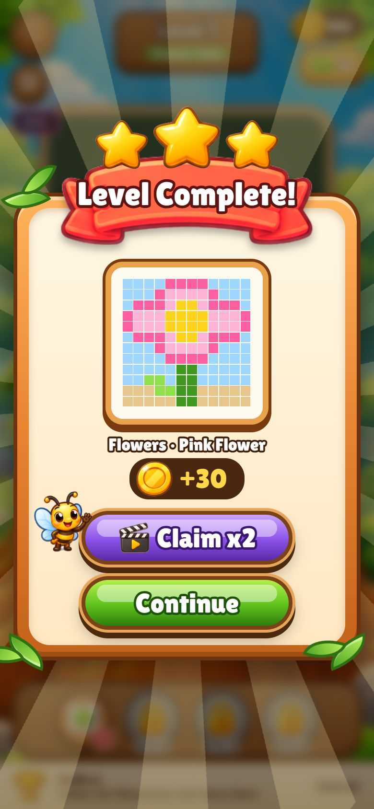
- After the tap: empty board, coins still 100

  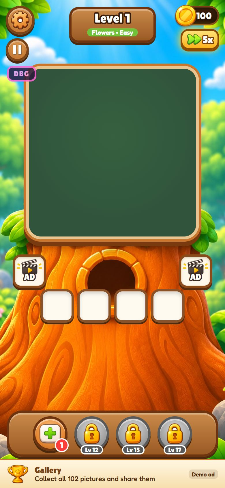
- `test-progression/evidence/PR-W2-run1-state.json`: coins 100 before and after, progress saved
- `test-progression/evidence/PR-W2-run3-escape.webm`: Run 3: Escape key
- `test-progression/evidence/PR-W2-run3-state.json`: Same result with Escape
- `test-progression/evidence/PR-W1-state.json`: Control: Continue pays 100 -> 130
- `index.html:423`: 
 (no data-locked; popup-fail at index.html:458 has it)
- `js/app.js:3028`: if (openPopupEl && e.target === openPopupEl) return closePopup();

**Suspected cause (hypothesis):** popup-complete lacks the data-locked attribute, so the generic outside-tap and Escape handlers (app.js:237, 3028) close it without calling finishWin().

**Suggested fix:** Add data-locked to #popup-complete (index.html:423), as #popup-fail already has.

### BUG-002: Top bar overflows on 360-390 px phones: the Settings gear (menu) and the Close X (store) are cut or pushed off screen, completely from 9,999 coins

**Severity:** major · **Type:** bug · **Area:** Phone portrait (360, 390, 412 px) · **Status:** confirmed · **Repro:** 2/2

**Environment:** Web, touch, widths 360 / 390 / 412 px, 15 balance combinations per run

**Steps**

1. Open the game on a 360 px wide phone (a very common Android width) with 9,999 coins
2. Look at the top-right corner of the main menu, then open the Store

**Expected:** Level, gems, coins and the Settings gear (menu) / Close X (store) all fit on screen at any balance

**Actual:** 360 px: gear 29 of 42 px visible at the starting balance, 0 px (fully off screen) at 9,999 and 98.8K/123.5K coins; the store has no visible Close X. 390 px: gear cut from 9,999 coins. 412 px: only the store X slightly cut at 98.8K/123.5K.

**Evidence**

- 360 px store, 123.5K coins: no Close X

  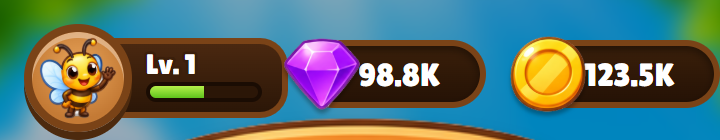
- 360 px menu: no Settings gear

  
- 360 px, starting balance: gear already cut

  
- Control: 412 px fits

  
- `test-ui/evidence/UI-20-run1-top-bar.json`: Visible px of gear and X for 15 cases
- `test-ui/evidence/UI-20-run2-top-bar.json`: Run 2: identical

**Suspected cause (hypothesis):** The top-bar pills have fixed minimum widths and the row does not shrink or wrap below ~400 px; numbers from 1,000 to 9,999 are shown in full (formatNumber only abbreviates from 10,000), so they are the widest case.

**Suggested fix:** Let the currency pills shrink (min-width: 0, smaller font under 400 px) and abbreviate from 1,000 (1.2K); keep the gear/X outside the flexible area so it can never be pushed out.

### BUG-003: Store keeps selling the $4.99 Special Offer, which includes No Ads, to players who already own No Ads

**Severity:** major · **Type:** bug · **Area:** Ownership (No Ads, Special Offer) · **Status:** confirmed · **Repro:** 2/2

**Preconditions:** No Ads owned (bought alone for $2.99 or in an earlier offer)

**Steps**

1. Open the Store
2. Look at the Special Offer card
3. Tap $4.99

**Expected:** The offer is hidden once No Ads is owned, or shown without No Ads at a new price (the No Ads card already shows 'Owned')

**Actual:** The card still lists '1,200 gems · 10,000 coins · No Ads' for $4.99 and can be bought again; the toast says 'No Ads' was granted again. With real payments this charges for a non-consumable the player owns.

**Evidence**

- Offer card with 'No Ads' while No Ads is owned

  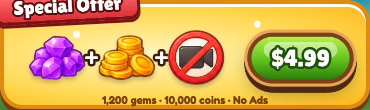
- `test-store/evidence/ST-08-run1.webm`: Run 1: buying the offer again
- Toast: '+1,200 gems, +10K coins, No Ads'

  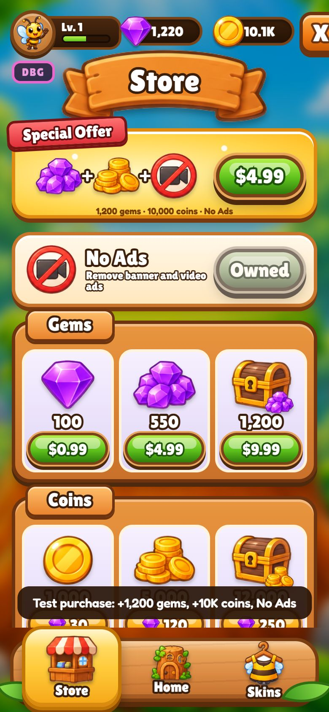
- `test-store/evidence/ST-08-run1-state.json`: noAds true before; gems 20 -> 1,220
- `test-store/evidence/ST-08-run2-state.json`: Run 2: same result
- `js/app.js:313`: The offer card is always rendered in renderStore (no state.noAds check)
- `js/app.js:698`: The offer popup already skips No Ads owners: if (... !state.noAds ...) openOffer()

**Suspected cause (hypothesis):** renderStore() builds the offer card unconditionally, while maybeShowOffer() already checks state.noAds.

**Suggested fix:** Hide the offer card when state.noAds is true (same rule as the popup), or show a variant without No Ads.

### BUG-004: Add Slot from the Out of Slots popup has no maximum: repeated fails grow the board to 10 squeezed slots (the booster stops at 7)

**Severity:** minor · **Type:** bug · **Area:** Slot limits · **Status:** confirmed · **Repro:** 3/3

**Environment:** Web, 390x844 touch. Fails triggered with the debug 'Lose level' (assisted); Add Slot and the ad are the real flow

**Steps**

1. Start Flowers Easy level 1 (4 slots)
2. Run out of slots, tap 'Add Slot' on the Out of Slots popup and watch the 3 s ad
3. Run out of slots again and repeat 6 times

**Expected:** Same limit as the Add Slot booster: 'Maximum slots reached' at 7 slots

**Actual:** Slots go 4, 5, 6, 7, 8, 9, 10. At 10 they shrink to thin pills across the full width and the first slot's block is wider than its neighbours.

**Evidence**

- 10 slots after 6 ads

  
- `test-puzzles/evidence/PZ-35-run1-add-slot.webm`: Run 1: the last Add Slot rounds
- Full screen

  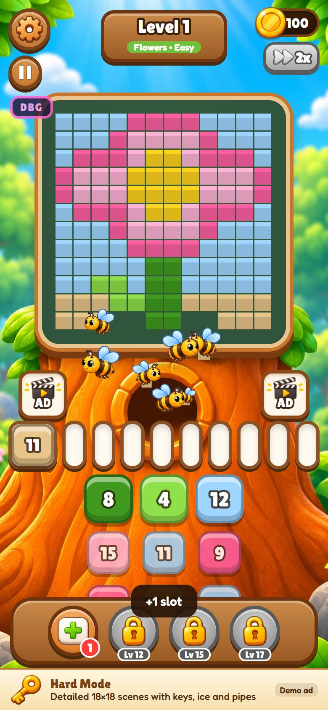
- `test-puzzles/evidence/PZ-35-run1-state.json`: Slot count after each ad
- `test-puzzles/evidence/PZ-35-run2-state.json`: Run 2: same counts
- `js/app.js:2681`: 'fail-addslot': () => showAd(() => { ... game.slots.push(null) ... }) (no limit)
- `js/app.js:2122`: Booster: if (g.slots.length >= 7) return toast('Maximum slots reached')

**Suspected cause (hypothesis):** The fail-popup handler pushes a slot without the 7-slot check that useBooster('add_slot') has.

**Suggested fix:** Apply the same limit in 'fail-addslot' and hide or disable the Add Slot button on the fail popup at 7 slots.

### BUG-005: Phone landscape (web): the Levels / Play block covers the Activities and Events buttons on the main menu

**Severity:** minor · **Type:** bug · **Area:** Phone landscape (web) · **Status:** confirmed · **Repro:** 2/2

**Environment:** Web, 844x390 touch. The Android app is locked to portrait (AndroidManifest.xml:18), so this affects the browser build only

**Steps**

1. Open the web build on a phone held in landscape
2. Tap Events (right side) or Activities (left side)

**Expected:** Side buttons are tappable, or the game asks to rotate to portrait

**Actual:** The .actions block (Levels and Play) lies on top of both buttons; a tap on their centre hits Play/Levels instead. The logo is also covered.

**Evidence**

- 844x390 main menu

  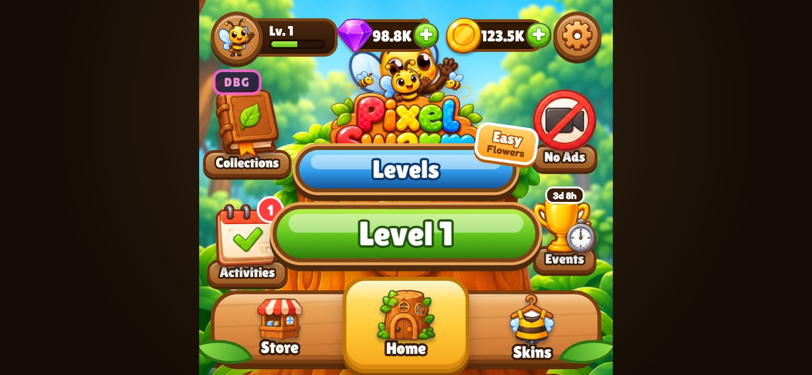
- `test-ui/evidence/UI-11-run1-click-blocked.log`: Run 1: the Events click is intercepted by .actions
- `test-ui/evidence/UI-layout-probe.json`: Run 2: probe reports both buttons covered by .actions

**Suggested fix:** Show a 'rotate your phone' screen in landscape on touch devices (matching the portrait-only app), or give landscape its own menu layout.

### BUG-006: Several buttons are below the 44 px touch-target guideline on phones (top-bar currency buttons, store Buy, in-level Pause and Speed)

**Severity:** minor · **Type:** bug · **Area:** Accessibility: touch targets · **Status:** confirmed · **Repro:** 2/2

**Environment:** 390x844 touch

**Steps**

1. Measure the on-screen size of every visible button on the menu, store, settings and a level

**Expected:** At least 44x44 CSS px (Apple HIG; Android recommends 48 dp)

**Actual:** Gems/coins top-bar buttons 76x34 and 79x34; store Buy buttons 95x38 (x6); Copy player ID 77x38; in-level Pause 40x40; Speed 67x36

**Evidence**

- `catalog/evidence/CT-A11Y-1-run1-small-targets.json`: Run 1 measurements
- `catalog/evidence/CT-A11Y-1-run2-small-targets.json`: Run 2: identical
- Level: Pause (top left) and Speed (top right)

  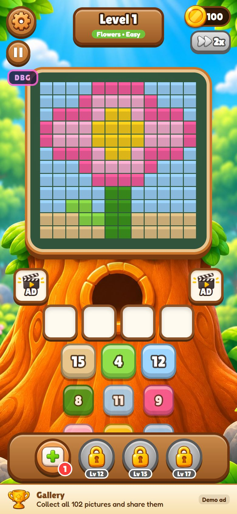
- Store Buy buttons

  

**Suggested fix:** Grow the hit area to 44 px without changing the art, e.g. padding or an ::after hit box on these buttons.

### BUG-007: No favicon: every page load logs a 404 error in the console

**Severity:** trivial · **Type:** bug · **Area:** Smoke gate · **Status:** confirmed · **Repro:** static

**Steps**

1. Open the game in a browser with the developer console open

**Expected:** The page declares an icon and the console stays clean

**Actual:** index.html has no <link rel="icon">; the browser requests /favicon.ico, gets 404 and logs 'Failed to load resource'. Seen on every boot in this run.

**Evidence**

- `smoke/evidence/SM-06-favicon-check.txt`: 404 on /favicon.ico and no icon link in index.html
- `smoke/evidence/SM-03-boot-log.json`: Console during the first launch

**Suggested fix:** Add <link rel="icon" href="assets/sprites/bee.png"> (or a favicon.ico) to index.html. It also gives the browser tab an icon.

### TXT-001: The swarm is called 'bees' in some texts and 'bugs' in others, even in two consecutive How to Play cards

**Severity:** minor · **Type:** text · **Area:** Terminology and consistency · **Status:** confirmed · **Repro:** static

**Expected:** One term for the creatures the player sends out. The game has 6 bug types (Bee, Ladybug, Beetle, Butterfly, Ant, Firefly) and a 'Bugs' collection tab, so 'bugs' is the general term; 'bees' is only right when the Bee is equipped.

**Actual:** How to Play card 2 says 'bees fly out of the tree', card 3 says 'bugs enter the picture'. The tutorial and three toasts say 'bees'; the lock toast and a notification say 'bugs'.

**Evidence**

- Card 2 'bees fly out', card 3 'bugs enter the picture'

  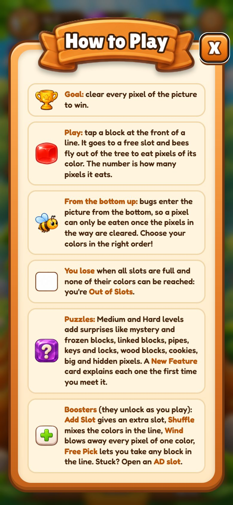
- `index.html:510`: ...bees fly out of the tree to eat pixels of its color.
- `index.html:511`: From the bottom up: bugs enter the picture from the bottom...
- `js/app.js:2251`: Tutorial: ...bees fly out of the tree to eat its color.
- `js/app.js:2252`: Tutorial: Bees eat from the bottom up...
- `js/app.js:2253`: Tutorial: ...no bee can reach its color...
- `js/app.js:1725`: Toast: The bees are eating {color} pixels
- `js/app.js:1728`: Toast: This {color} block is waiting for the bees
- `js/app.js:1880`: Toast: No free slot — wait for the bees!
- `js/app.js:1900`: Toast: Locked! The bugs must collect its key
- `js/native.js:72`: Notification: Your bugs miss you!

**Suggested fix:** Use 'bugs' in all general texts (e.g. 'bugs fly out of the tree', 'Bugs eat from the bottom up', 'wait for the bugs'). Optionally insert the equipped bug's name where the sentence is about the current swarm.

### TXT-002: Tutorial step dots are drawn on top of the ad banner text at the bottom of the game screen

**Severity:** minor · **Type:** text · **Area:** Text in context (layout, overlap, truncation) · **Status:** confirmed · **Repro:** 3/3

**Environment:** Mobile viewport 390x844 @2x, fresh tutorial (#tutorial)

**Preconditions:** Tutorial not seen yet (new player)

**Steps**

1. Start the first level as a new player (or open the build with #tutorial)
2. Look at the bottom of the screen while the first tutorial bubble is shown

**Expected:** The six tutorial step dots sit in free space and the banner text stays readable

**Actual:** The dots are painted over the middle of the banner text on every run, whichever banner slide is showing (Halloween Event on run 1, Hard Mode on run 2, Gallery on run 3)

**Evidence**

- Close-up, run 3: dots over 'Collect all 102 pictures and share them'

  
- Full screen, run 3

  
- Full screen, run 1: dots over the 'Halloween Event' banner text

  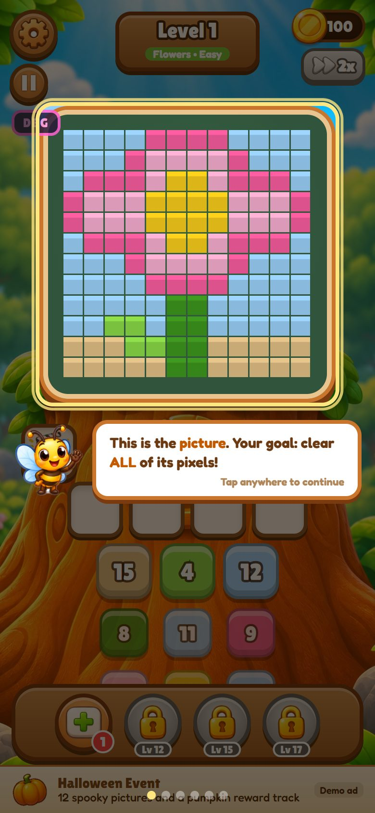
- `css/style.css:879`: .tut-dots { position: absolute; ... bottom: calc(14px + var(--sa-bottom)); }

**Suspected cause (hypothesis):** Likely the dots are positioned a fixed 14px from the bottom of the screen, which is inside the 50px ad banner (.ad-banner, css/style.css:761).

**Suggested fix:** Place the dots inside the tutorial bubble, or offset them above the banner (bottom: banner height + 14px); hide the banner during the tutorial if that is acceptable.

### TXT-003: Store: the No Ads subtitle is cramped and leaves 'ads' alone on a second line on phone widths

**Severity:** minor · **Type:** text · **Area:** Text in context (layout, overlap, truncation) · **Status:** confirmed · **Repro:** 3/3

**Environment:** Mobile viewport 390x844 and 360x740

**Steps**

1. Open the Store from the bottom navigation
2. Look at the No Ads card under the Special Offer

**Expected:** 'Remove banner and video ads' readable, letters not touching, no single-word orphan line

**Actual:** At 390px the outline makes letters touch and 'ads' wraps alone; at 360px it wraps after 'and' and stays cramped

**Evidence**

- Close-up at 360px: cramped letters

  
- Full store at 390px (run 3): 'ads' alone on line 2

  
- Run 1, 390px: same result

  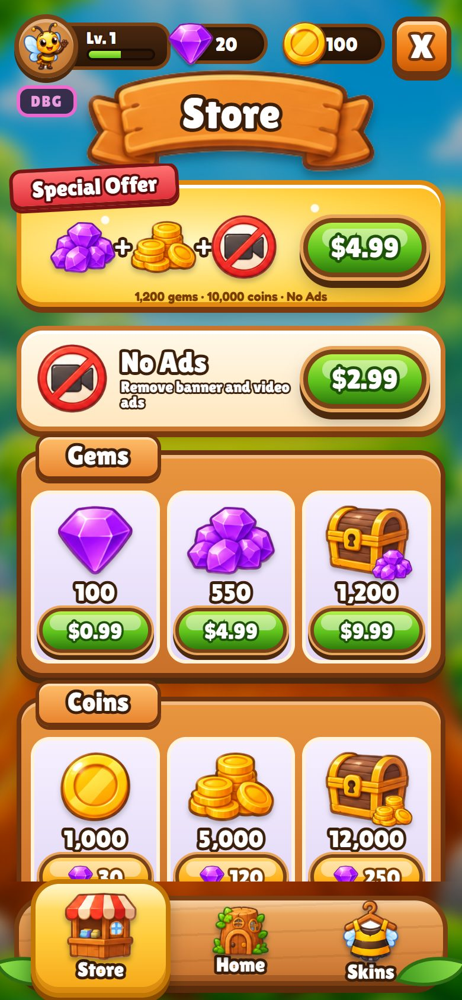
- `css/style.css:964`: .card-title small { font-size: 13px; -webkit-text-stroke: 3px var(--ink); }

**Suspected cause (hypothesis):** A 3px text stroke on 13px text eats the space between letters; the card title area is narrow next to the price button.

**Suggested fix:** Reduce the stroke for the small subtitle (1.5 to 2px) or drop it, and shorten the copy to 'No banner or video ads'.

### TXT-004: Booster descriptions say 'in line' where How to Play says 'in the line', and describe Shuffle differently

**Severity:** trivial · **Type:** text · **Area:** Terminology and consistency · **Status:** confirmed · **Repro:** static

**Expected:** Shuffle: 'Mixes the colors of the blocks in the line.' Free Pick: 'Pick any block in the line and send it to a free slot.'

**Actual:** 'Changes the colors of the blocks in line.' and 'Pick any block in line...' (missing 'the'; 'changes' vs 'mixes' in How to Play)

**Evidence**

- New Booster popup: 'Changes the colors of the blocks in line.'

  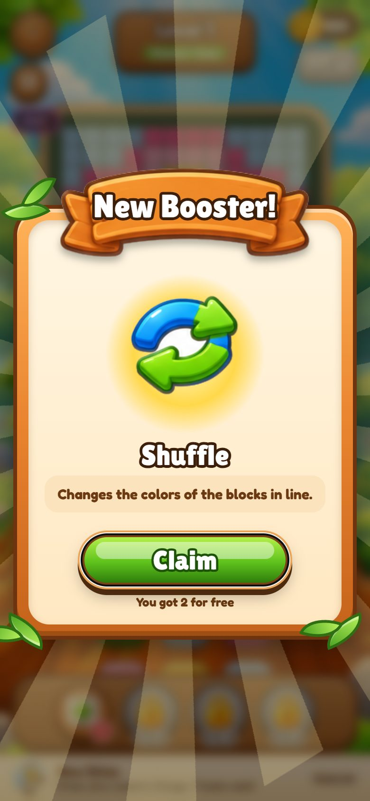
- `js/app.js:1127`: desc: 'Changes the colors of the blocks in line.'
- `index.html:450`: Same text in the static popup markup
- `js/app.js:1129`: desc: 'Pick any block in line and send it to a free slot.'
- `index.html:514`: How to Play: 'Shuffle mixes the colors in the line ... any block in the line'

**Suggested fix:** Mixes the colors of the blocks in the line. / Pick any block in the line and send it to a free slot.

### TXT-005: 'Out of Slots' is capitalised mid-sentence in How to Play but lowercase in the tutorial

**Severity:** trivial · **Type:** text · **Area:** Terminology and consistency · **Status:** confirmed · **Repro:** static

**Expected:** The same casing for the same term in running text (the popup title 'Out of Slots!' can stay Title Case)

**Actual:** How to Play: 'you're Out of Slots.'; tutorial: 'you're out of slots and you lose.'

**Evidence**

- Card 4: 'you're Out of Slots.'

  
- `index.html:512`: you're <b>Out of Slots</b>.
- `js/app.js:2253`: you're out of slots and you lose.

**Suggested fix:** Pick one: keep the highlighted 'Out of Slots' as a named state in both places, or lowercase it in How to Play.

### TXT-006: Two ellipsis styles: 'Loading...' (three dots) vs 'Sending…' and 'Taking a screenshot…'

**Severity:** trivial · **Type:** text · **Area:** Terminology and consistency · **Status:** confirmed · **Repro:** static

**Expected:** One ellipsis style across the game

**Actual:** The loading screen uses '...'; the Report popup (Settings > Report) uses the '…' character

**Evidence**

- Loading screen

  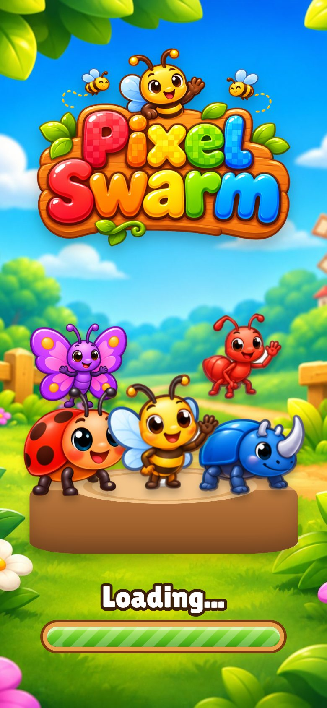
- `index.html:38`: 
Loading...

- `js/report.js:199`: 'Sending…'
- `js/report.js:123`: 'Taking a screenshot…'

**Suggested fix:** Loading…

### TXT-101: Special Offer toast says '+10K coins' while the card and other toasts use full numbers ('10,000 coins', '+1,000 coins')

**Severity:** trivial · **Type:** text · **Area:** Edge cases · **Status:** confirmed · **Repro:** static

**Expected:** Test purchase: +1,200 gems, +10,000 coins, No Ads

**Actual:** Test purchase: +1,200 gems, +10K coins, No Ads

**Evidence**

- Toast with '10K'

  
- `js/app.js:378`: uses the HUD formatNumber (K/M); renderStore uses a full-number formatter (app.js:311)

**Suggested fix:** Use the store's full-number format in purchase toasts.

### QRY-001: New Feature card titles mix plural and singular names

**Severity:** - · **Type:** query · **Area:** Terminology and consistency · **Status:** confirmed

**Actual:** Plural: Mystery Blocks, Frozen Blocks, Hidden Pixels, Linked Blocks, Mystery Links. Singular: Big Pixel, Pipe, Key & Lock, Wood Block, Cookie Blocker (5 vs 5, no majority style).

**Evidence**

- `js/app.js:2214`: FEATURES titles, lines 2214 to 2227

**Suggested fix:** If a rule is wanted: plural for all (Big Pixels, Pipes, Keys & Locks, Wood Blocks, Cookie Blockers). Design decision, not a defect.

### QRY-002: Purchase toasts say 'Test purchase' and the banner says 'Demo ad' in the public build

**Severity:** - · **Type:** query · **Area:** Store and monetisation copy · **Status:** confirmed

**Steps**

1. Open the Store
2. Tap the $0.99 gems pack

**Actual:** Toast 'Test purchase: +100 gems'; gems go from 20 to 120 with no payment. The bottom banner is labelled 'Demo ad'.

**Evidence**

- 'Test purchase: +100 gems' toast

  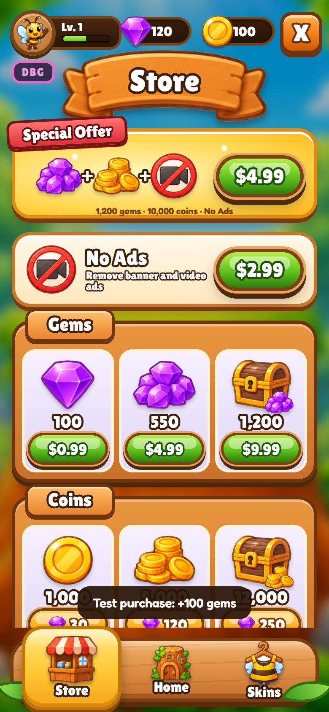
- `js/app.js:388`: toast(`Test purchase: +${formatNumber(g.amount)} gems`)
- `index.html:529`: Demo ad

**Suggested fix:** Fine for a portfolio demo. Before a store release, confirm these strings are replaced together with the real purchase and ad SDKs.

### QRY-003: Terms of Service and Privacy Policy links on the age gate only show 'coming soon'

**Severity:** - · **Type:** query · **Area:** Store and monetisation copy · **Status:** confirmed

**Steps**

1. Launch the game on a fresh profile
2. On the age gate, tap Privacy Policy

**Actual:** Toast 'Privacy Policy — coming soon'; same for Terms of Service and the Settings links

**Evidence**

- Toast on the age gate

  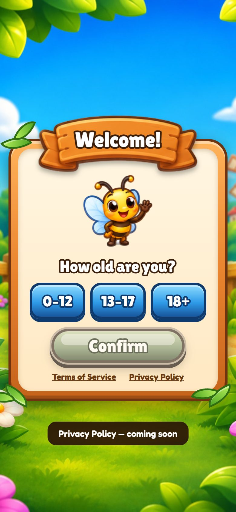
- `js/app.js:262`: toast({ privacy: 'Privacy Policy', terms: 'Terms of Service' }[key] + ' — coming soon')

**Suggested fix:** Expected for a prototype. App stores require a reachable privacy policy for games that ask for age and show ads, so plan real pages before submission.

### QRY-101: A double tap on a coin pack buys two packs (no confirmation, no debounce)

**Severity:** - · **Type:** query · **Area:** Edge cases · **Status:** confirmed

**Steps**

1. Store with 120 gems
2. Double-tap the 1,000 coins pack (30 gems)

**Actual:** Two packs bought: 120 -> 60 gems, 100 -> 2,100 coins

**Evidence**

- After the double tap

  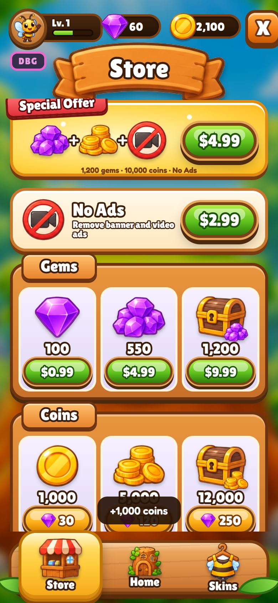

**Suggested fix:** If accidental purchases matter, ignore a second tap on the same item for ~500 ms, or add a confirm step for premium currency.
