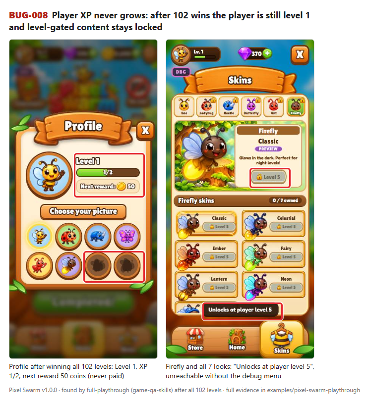

# Full playthrough: Pixel Swarm v1.0.0

The `full-playthrough` skill finished **every level of Pixel Swarm** from a fresh install: 5 themes × 3 difficulties × 6 levels, plus the 12 levels of the Halloween event. That's 102 levels, played through the game's own buttons on 2026-11-16 (build v1.0.0, commit `db96df5`, web, phone viewport 390x844).

**Open [`completion-report.html`](completion-report.html)** (download it and open it in a browser) to see the proof: the Level Complete screen of every level, with its stars, time and reward.

## Results

| | |
|---|---|
| Levels completed | **102/102**: 90 theme levels + 12 event levels |
| Attempts | 102: every level won on its first attempt |
| Stars | 3 stars on all 102 levels (stars saved = stars shown) |
| Time to complete | **1 h 34 min** from first launch to the last level (15:42 → 17:17 UTC), including menus, ads, reloads and one restart of the test |
| Time playing levels | **1 h 12 min 44 s** (level start to win, summed over 102 levels) |
| Taps on blocks | 3,875 real clicks |
| Coins from wins | 4,590, exactly the game's rule (Easy 30, Medium 45, Hard 60 per win) |
| Persistence | 17/17 reload checks kept the progress (one per section) |
| Event | 12/12 levels, 120 pumpkins, all 5 track rewards paid (500 coins, 50 gems, 1,500 coins, 100 gems, 3,000 coins + 200 gems); a second claim is refused |
| End state | Gallery shows "Completed 102/102"; 6/6 levels in all 15 sections; 0 script errors |
| Bugs found | **1, BUG-008 (major)**: player XP never grows (below) |

### Time per difficulty

| Difficulty | Levels | Play time | Average | Fastest–slowest |
|---|---|---|---|---|
| Tutorial level (1x speed) | 1 | 1 min 52 s | 112 s | 112 s |
| Easy | 29 | 9 min 59 s | 21 s | 19–22 s |
| Medium | 30 | 21 min 40 s | 43 s | 40–47 s |
| Hard | 30 | 31 min 02 s | 62 s | 54–70 s |
| Event Easy / Medium / Hard | 4 / 4 / 4 | 1 min 19 s / 2 min 47 s / 4 min 05 s | 20 / 42 / 61 s | 19–66 s |

### Time per theme

| Theme | Levels | Play time | Average |
|---|---|---|---|
| Flowers (includes the tutorial level) | 18 | 14 min 09 s | 47 s |
| Fruits | 18 | 12 min 42 s | 42 s |
| Animals | 18 | 12 min 33 s | 42 s |
| Sweets | 18 | 12 min 47 s | 43 s |
| Ocean | 18 | 12 min 22 s | 41 s |
| Halloween event | 12 | 8 min 11 s | 41 s |

## How it was played

- **Fresh install:** age gate, story, welcome screen, then the tutorial level with all 6 tutorial steps.
- **Real input only:** every move is a click on a block in the game. The order follows the solution order of the game's own solver (columns in rotation, one block at a time, special rules for hammers, frozen and linked blocks), read from what is on screen. The game's auto-solve, level skip and win cheats were never used.
- **One logged aid:** 500 gems from the debug menu, spent in the game's Speed Store on the permanent 8x speed. At the start of each level the player taps the speed button up to 8x, as a real player would. Only the time was saved; the levels themselves were not made easier.
- **After every win** the script checked the reward on the popup, the coins actually paid, the stars saved and which level opened next. **After every 6-level section** it reloaded the game and checked the progress was still saved.
- **Resumable:** the browser profile and a copy of the save are kept after each level, so a stop, a crash or a session limit never loses the run.

## Notes on the evidence

- **Faint screenshots on levels 1–50.** Their Level Complete screens were captured while the popup was still fading in, so they look faint (the level, "Level Complete!" and the reward are still readable). From level 51 the script waits for the popup to finish. The save data in [`inventory.json`](inventory.json) confirms every win either way.
- **One level was played twice.** To move the run into a durable folder, the test was stopped about a second after a win on Sweets level 10, before that win reached the save. The game then correctly kept the next level locked. On the next start the script compared the save with its records, found the missing win, replayed the level and continued. This was an interruption of the test, not a game bug. The persistence check taken during it is not counted, and the full-playthrough skill now does this check on every start.
- **First-try wins in the game's stats show 90, not 102.** The game counts a level as attempted when it starts. At each section boundary the test reloaded the page after the game had already started the next level, so 12 levels have 2 "attempts" in the save. Every level was still won on its first played attempt.

## Bug found: BUG-008, player XP never grows

**Major.** After 102 wins the player is still level 1 with XP 1/2. Nothing in the game adds XP: only the debug menu changes the player level (`js/app.js:2611`). So the Firefly bug and its 7 looks (level 5) and two avatars (levels 10 and 20) can't be unlocked by playing, and the "Next reward: 50" coins shown in the Profile is never paid. Reproduced 2/2: after the 102-level run, and on a fresh player after 1, 2 and 3 wins. Details: [`report.md`](report.md) · [video](evidence/BUG-008-after-102-wins.webm) · [save data](evidence/BUG-008-state.json) · [all bugs](../../FOUND-BUGS.md).

Status: **open**, not fixed in the game yet.

## Files

| File | What it is |
|---|---|
| [`completion-report.html`](completion-report.html) | The completion report: totals, time tables, every level's Level Complete screen, end state, method |
| [`inventory.md`](inventory.md) / [`inventory.json`](inventory.json) | One row per level: status, attempts, time, stars, reward expected/got, next level, evidence |
| [`playthrough-log.md`](playthrough-log.md) | Every event in the order it happened |
| [`report.md`](report.md) / [`report.html`](report.html) / [`findings.json`](findings.json) | The standard QA report: coverage per theme and BUG-008 |
| [`evidence/`](evidence) | Screenshots per level (`NNN-complete.jpg`), the start of each section, end state (`90x-*.jpg`), BUG-008 video and data |
| [`scripts/playthrough.mjs`](scripts/playthrough.mjs) | The player: real clicks, checks, inventory, resume, reconcile |
| [`scripts/report.mjs`](scripts/report.mjs) | Builds the completion report from the inventory |
| [`scripts/xp-check.mjs`](scripts/xp-check.mjs) | Captures the BUG-008 evidence |

To run it again: serve the game (`node scripts/dev-server.mjs` in the Pixel Swarm repo, port 5199), install `playwright-core` in this folder, then `PROFILE_DIR=.state/profile node scripts/playthrough.mjs`. Repeat that command until every row is final, then run `node scripts/report.mjs`.
