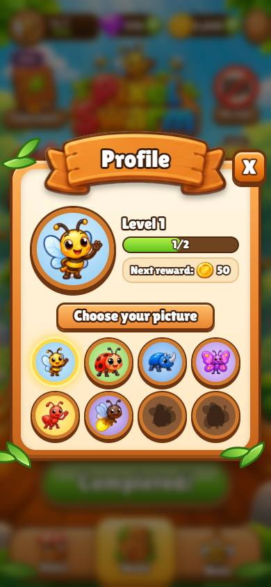
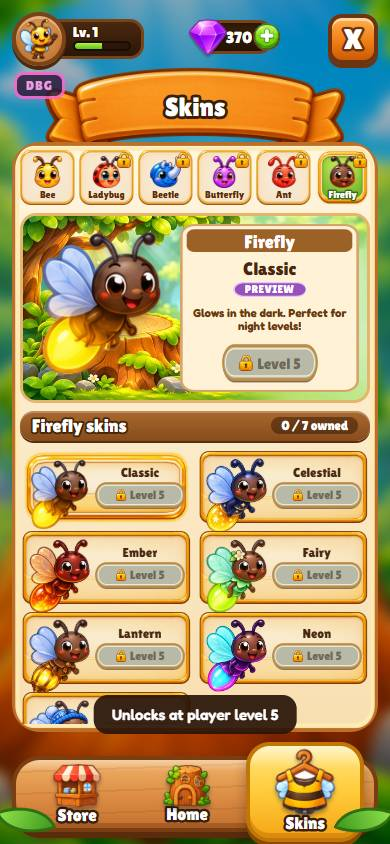

# QA Report: Pixel Swarm

**Verdict: FAIL**

Completed 102/102 levels from a fresh install, every one won on its first attempt with 3 stars, in 1 h 34 min (1 h 12 min of actual play). Rewards, stars, unlocks, saves and the event reward track were all correct. One major bug: player XP never grows, so after 102 wins the player is still level 1 and the Firefly bug and two avatars can never be unlocked by playing.

| | |
|---|---|
| Skill | full-playthrough |
| Build | v1.0.0 debug build (commit db96df5) |
| Platform | Web, Microsoft Edge (Chromium, headless), 390x844 touch, persistent browser profile |
| Access | Playwright (scripts/playthrough.mjs): real clicks in the solution order, read from the screen; save read after every level. Logged economy aid: 500 debug gems spent on the 8x speed tier in the Speed Store |
| Date | 2026-11-16 |
| Tester | Claude (AI-assisted QA) |
| Scope | All content: 5 themes x 3 difficulties x 6 levels + 12 Halloween event levels (102), rewards and stars after every win, unlock order, persistence after every section, event reward track, end state |

**Confirmed:** 0 blocker · 0 critical · 1 major · 0 minor · 0 trivial

## Coverage

| Area | Status | Checks | Findings | Notes |
|---|---|---|---|---|
| Flowers (18 levels) | PASS | 18/18 |  | 849 s of play (includes the tutorial level at 1x) |
| Fruits (18 levels) | PASS | 18/18 |  | 762 s of play |
| Animals (18 levels) | PASS | 18/18 |  | 753 s of play |
| Sweets (18 levels) | PASS | 18/18 |  | 767 s of play. Level 10 was played twice: its first win was lost when the test harness was stopped mid-write (not a game bug); the reconcile step replayed it |
| Ocean (18 levels) | PASS | 18/18 |  | 742 s of play |
| Halloween event (12 levels + reward track) | PASS | 13/13 |  | 491 s of play; +10 pumpkins per win (120); all 5 rewards paid as listed (500 coins, 50 gems, 1,500 coins, 100 gems, 3,000 coins + 200 gems); a second claim is refused |
| Rewards, stars and unlock order | PASS |  |  | Every win paid exactly 30 / 45 / 60 coins (4,590 in total = coinsEarned in the save), stars saved = stars shown, and the next level / difficulty opened as the rules say. Details per level in inventory.md. |
| Persistence | PASS | 17/17 |  | Reload after each section: progress kept. One more check (sweets-medium 3/4) was taken while the harness had lost a write and is not counted. |
| End state | PASS |  |  | Gallery 'Completed 102/102', 6/6 levels in all 15 sections, event 12/12, stats.levels 102, 0 page errors. |
| Player level and XP | FAIL |  | BUG-008 |  |

## Findings

| ID | Severity | Type | Status | Title |
|---|---|---|---|---|
| BUG-008 | major | bug | confirmed | Player XP never grows: after 102 wins the player is still level 1, so the Firefly bug and two avatars can never be unlocked |

### BUG-008: Player XP never grows: after 102 wins the player is still level 1, so the Firefly bug and two avatars can never be unlocked

**Severity:** major · **Type:** bug · **Area:** Player level and XP · **Status:** confirmed · **Repro:** 2/2

**Environment:** Run 1: the save after all 102 levels. Run 2: a fresh player winning 3 levels

**Preconditions:** Any player

**Steps**

1. Win levels (any number)
2. Open the Profile (tap the avatar)
3. Open Skins > Firefly

**Expected:** Wins give XP, the player levels up (the Profile promises 'Next reward: 50' coins) and level-gated content opens: Firefly at level 5, avatars at levels 10 and 20

**Actual:** XP stays 1/2 and the player stays level 1 after 1, 2, 3 and 102 wins. The Firefly and all 7 of its looks say 'Unlocks at player level 5'; two avatars stay locked.

**Evidence**

- `evidence/BUG-008-after-102-wins.webm`: After 102 wins: Profile at level 1, Firefly locked
- Profile: Level 1, 1/2, next reward 50

  
- Firefly: 'Unlocks at player level 5'

  
- `evidence/BUG-008-state.json`: playerLevel 1 / xp 1 after 102 wins, and after 1-3 wins on a fresh player
- `js/app.js:2611`: The only code that raises playerLevel is the debug 'levelup' / 'xp' commands; nothing adds state.xp
- `js/app.js:570`: const LEVEL_UP_REWARD = 50 (shown in the Profile, never paid)
- `js/app.js:716`: Firefly: level: 5; avatars level 10 and 20 (app.js:568)

**Suspected cause (hypothesis):** The XP / level-up logic was never wired to gameplay: track('level') counts wins but does not add XP, and no code outside the debug menu changes playerLevel.

**Suggested fix:** In track('level') add XP per win (e.g. 1 per star), level up when xp >= xpToNext (grow xpToNext, pay LEVEL_UP_REWARD, show a toast), then re-render the HUD.
