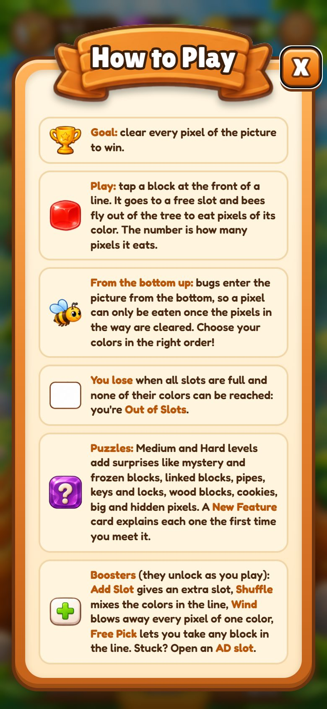
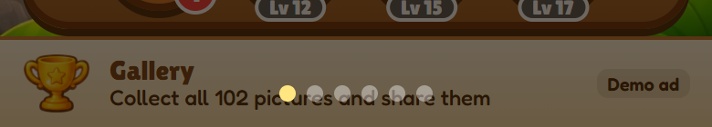
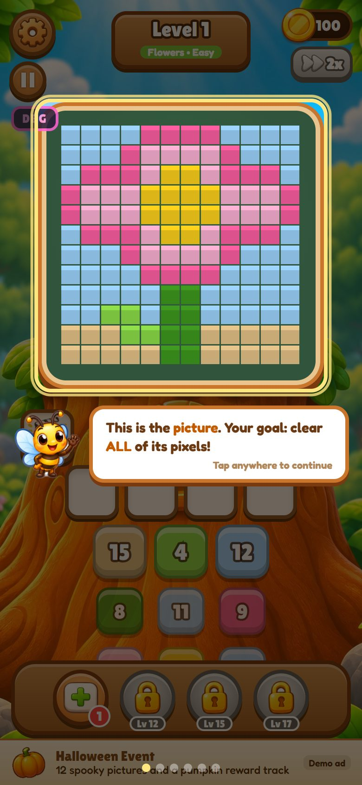
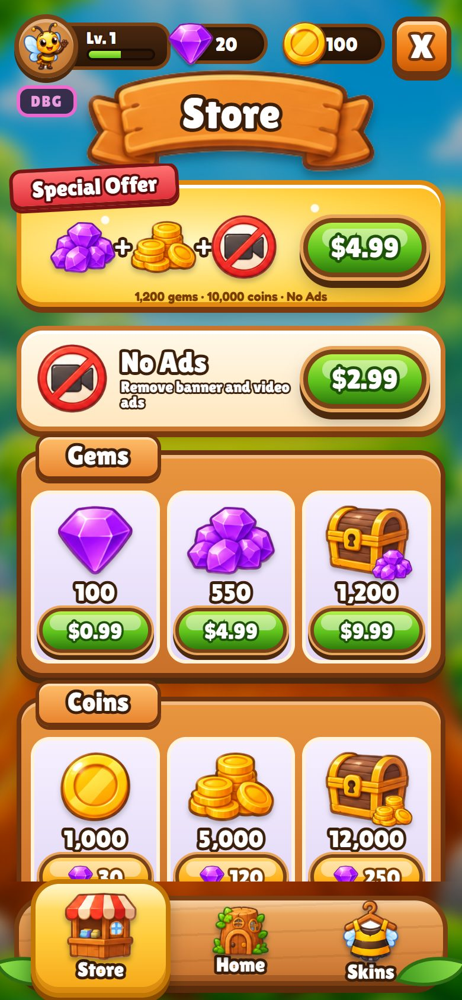
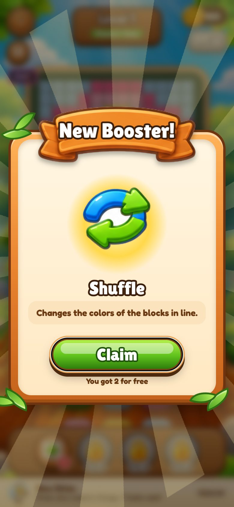
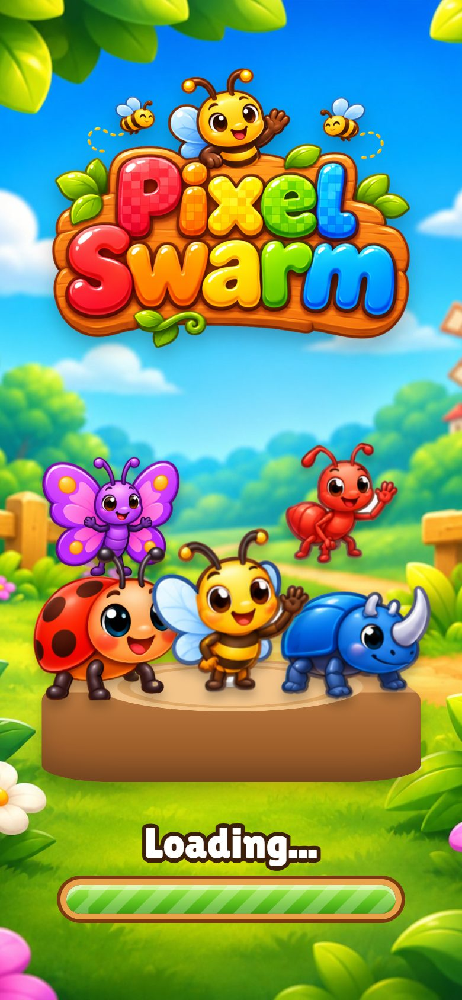
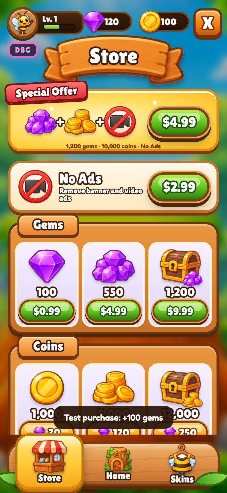
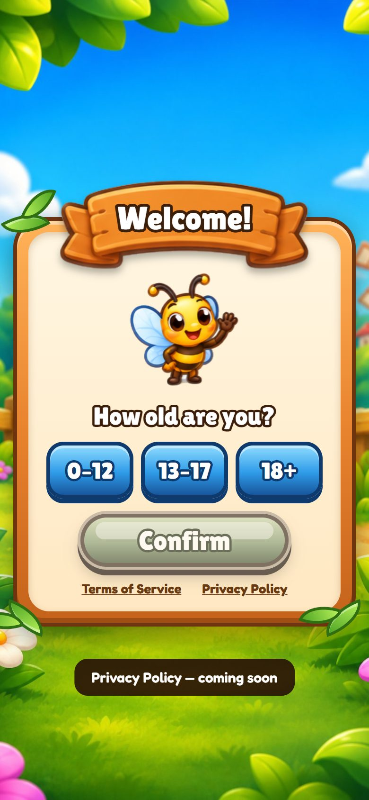

# QA Report: Pixel Swarm

**Verdict: PASS WITH ISSUES**

The copy is clean: no spelling or grammar errors in 861 strings, and the numbers in the text match the game data. The issues are consistency ('bees' vs 'bugs', 'in line' vs 'in the line') and two in-context layout problems seen only in the running game: tutorial dots drawn over the ad banner text and a cramped No Ads subtitle. Three queries ask whether demo wording and placeholder legal links are intended for the public build.

| | |
|---|---|
| Skill | text-review |
| Build | v1.0.0 debug build (commit db96df5) |
| Platform | Web, Microsoft Edge (Chromium), mobile viewport 390x844 @2x, plus 360x740 |
| Access | Source scan (extract-strings.mjs, 861 strings) + Playwright session against the local build (scripts/session.mjs) |
| Date | 2026-11-16 |
| Tester | Claude (AI-assisted QA) |
| Scope | All player-facing English text: HTML screens, popups, tutorial, story, store, boosters, feature cards, toasts, notifications, skins, picture names. Out of scope: the DBG debug panel, performance overlay, level-check tools and code comments. |

**Confirmed:** 0 blocker · 0 critical · 0 major · 3 minor · 3 trivial

## Coverage

| Area | Status | Checks | Findings | Notes |
|---|---|---|---|---|
| Spelling and grammar (all sources) | PASS | 861/861 |  | 861 candidate strings reviewed; 0 spelling or grammar errors. US spelling used consistently (color, armor, honorable). |
| Terminology and consistency | FAIL |  | TXT-001, TXT-004, TXT-005, TXT-006, QRY-001 |  |
| Numbers in text vs game data | PASS | 4/4 |  | 'Collect all 102 pictures' = 5 themes x 3 difficulties x 6 + 12 event levels; '12 spooky pictures' = 12; '6 bugs, 7 looks each' matches the skin table; '7 days in a row' matches DAILY_REWARDS (7 entries). |
| First launch (age gate, story, welcome) | PASS |  |  |  |
| Text in context (layout, overlap, truncation) | FAIL |  | TXT-002, TXT-003 |  |
| Store and monetisation copy | PARTIAL |  | QRY-002, QRY-003 | Copy is correct; two queries about demo wording and placeholder legal links. Store screens checked at 390 and 360 px only. |
| Text inside images | NOT_TESTED |  |  | Sprite and background art were not inspected for baked-in text. |
| Android notification delivery | NOT_TESTED |  |  | Notification strings were reviewed in source (js/native.js); seeing them on a device needs the Android build. |

## Findings

| ID | Severity | Type | Status | Title |
|---|---|---|---|---|
| TXT-001 | minor | text | confirmed | The swarm is called 'bees' in some texts and 'bugs' in others, even in two consecutive How to Play cards |
| TXT-002 | minor | text | confirmed | Tutorial step dots are drawn on top of the ad banner text at the bottom of the game screen |
| TXT-003 | minor | text | confirmed | Store: the No Ads subtitle is cramped and leaves 'ads' alone on a second line on phone widths |
| TXT-004 | trivial | text | confirmed | Booster descriptions say 'in line' where How to Play says 'in the line', and describe Shuffle differently |
| TXT-005 | trivial | text | confirmed | 'Out of Slots' is capitalised mid-sentence in How to Play but lowercase in the tutorial |
| TXT-006 | trivial | text | confirmed | Two ellipsis styles: 'Loading...' (three dots) vs 'Sending…' and 'Taking a screenshot…' |
| QRY-001 | - | query | confirmed | New Feature card titles mix plural and singular names |
| QRY-002 | - | query | confirmed | Purchase toasts say 'Test purchase' and the banner says 'Demo ad' in the public build |
| QRY-003 | - | query | confirmed | Terms of Service and Privacy Policy links on the age gate only show 'coming soon' |

### TXT-001: The swarm is called 'bees' in some texts and 'bugs' in others, even in two consecutive How to Play cards

**Severity:** minor · **Type:** text · **Area:** Terminology and consistency · **Status:** confirmed · **Repro:** static

**Expected:** One term for the creatures the player sends out. The game has 6 bug types (Bee, Ladybug, Beetle, Butterfly, Ant, Firefly) and a 'Bugs' collection tab, so 'bugs' is the general term; 'bees' is only right when the Bee is equipped.

**Actual:** How to Play card 2 says 'bees fly out of the tree', card 3 says 'bugs enter the picture'. The tutorial and three toasts say 'bees'; the lock toast and a notification say 'bugs'.

**Evidence**

- Card 2 'bees fly out', card 3 'bugs enter the picture'

  
- `index.html:510`: ...bees fly out of the tree to eat pixels of its color.
- `index.html:511`: From the bottom up: bugs enter the picture from the bottom...
- `js/app.js:2251`: Tutorial: ...bees fly out of the tree to eat its color.
- `js/app.js:2252`: Tutorial: Bees eat from the bottom up...
- `js/app.js:2253`: Tutorial: ...no bee can reach its color...
- `js/app.js:1725`: Toast: The bees are eating {color} pixels
- `js/app.js:1728`: Toast: This {color} block is waiting for the bees
- `js/app.js:1880`: Toast: No free slot — wait for the bees!
- `js/app.js:1900`: Toast: Locked! The bugs must collect its key
- `js/native.js:72`: Notification: Your bugs miss you!

**Suggested fix:** Use 'bugs' in all general texts (e.g. 'bugs fly out of the tree', 'Bugs eat from the bottom up', 'wait for the bugs'). Optionally insert the equipped bug's name where the sentence is about the current swarm.

### TXT-002: Tutorial step dots are drawn on top of the ad banner text at the bottom of the game screen

**Severity:** minor · **Type:** text · **Area:** Text in context (layout, overlap, truncation) · **Status:** confirmed · **Repro:** 3/3

**Environment:** Mobile viewport 390x844 @2x, fresh tutorial (#tutorial)

**Preconditions:** Tutorial not seen yet (new player)

**Steps**

1. Start the first level as a new player (or open the build with #tutorial)
2. Look at the bottom of the screen while the first tutorial bubble is shown

**Expected:** The six tutorial step dots sit in free space and the banner text stays readable

**Actual:** The dots are painted over the middle of the banner text on every run, whichever banner slide is showing (Halloween Event on run 1, Hard Mode on run 2, Gallery on run 3)

**Evidence**

- Close-up, run 3: dots over 'Collect all 102 pictures and share them'

  
- Full screen, run 3

  
- Full screen, run 1: dots over the 'Halloween Event' banner text

  
- `css/style.css:879`: .tut-dots { position: absolute; ... bottom: calc(14px + var(--sa-bottom)); }

**Suspected cause (hypothesis):** Likely the dots are positioned a fixed 14px from the bottom of the screen, which is inside the 50px ad banner (.ad-banner, css/style.css:761).

**Suggested fix:** Place the dots inside the tutorial bubble, or offset them above the banner (bottom: banner height + 14px); hide the banner during the tutorial if that is acceptable.

### TXT-003: Store: the No Ads subtitle is cramped and leaves 'ads' alone on a second line on phone widths

**Severity:** minor · **Type:** text · **Area:** Text in context (layout, overlap, truncation) · **Status:** confirmed · **Repro:** 3/3

**Environment:** Mobile viewport 390x844 and 360x740

**Steps**

1. Open the Store from the bottom navigation
2. Look at the No Ads card under the Special Offer

**Expected:** 'Remove banner and video ads' readable, letters not touching, no single-word orphan line

**Actual:** At 390px the outline makes letters touch and 'ads' wraps alone; at 360px it wraps after 'and' and stays cramped

**Evidence**

- Close-up at 360px: cramped letters

  
- Full store at 390px (run 3): 'ads' alone on line 2

  
- Run 1, 390px: same result

  
- `css/style.css:964`: .card-title small { font-size: 13px; -webkit-text-stroke: 3px var(--ink); }

**Suspected cause (hypothesis):** A 3px text stroke on 13px text eats the space between letters; the card title area is narrow next to the price button.

**Suggested fix:** Reduce the stroke for the small subtitle (1.5 to 2px) or drop it, and shorten the copy to 'No banner or video ads'.

### TXT-004: Booster descriptions say 'in line' where How to Play says 'in the line', and describe Shuffle differently

**Severity:** trivial · **Type:** text · **Area:** Terminology and consistency · **Status:** confirmed · **Repro:** static

**Expected:** Shuffle: 'Mixes the colors of the blocks in the line.' Free Pick: 'Pick any block in the line and send it to a free slot.'

**Actual:** 'Changes the colors of the blocks in line.' and 'Pick any block in line...' (missing 'the'; 'changes' vs 'mixes' in How to Play)

**Evidence**

- New Booster popup: 'Changes the colors of the blocks in line.'

  
- `js/app.js:1127`: desc: 'Changes the colors of the blocks in line.'
- `index.html:450`: Same text in the static popup markup
- `js/app.js:1129`: desc: 'Pick any block in line and send it to a free slot.'
- `index.html:514`: How to Play: 'Shuffle mixes the colors in the line ... any block in the line'

**Suggested fix:** Mixes the colors of the blocks in the line. / Pick any block in the line and send it to a free slot.

### TXT-005: 'Out of Slots' is capitalised mid-sentence in How to Play but lowercase in the tutorial

**Severity:** trivial · **Type:** text · **Area:** Terminology and consistency · **Status:** confirmed · **Repro:** static

**Expected:** The same casing for the same term in running text (the popup title 'Out of Slots!' can stay Title Case)

**Actual:** How to Play: 'you're Out of Slots.'; tutorial: 'you're out of slots and you lose.'

**Evidence**

- Card 4: 'you're Out of Slots.'

  
- `index.html:512`: you're <b>Out of Slots</b>.
- `js/app.js:2253`: you're out of slots and you lose.

**Suggested fix:** Pick one: keep the highlighted 'Out of Slots' as a named state in both places, or lowercase it in How to Play.

### TXT-006: Two ellipsis styles: 'Loading...' (three dots) vs 'Sending…' and 'Taking a screenshot…'

**Severity:** trivial · **Type:** text · **Area:** Terminology and consistency · **Status:** confirmed · **Repro:** static

**Expected:** One ellipsis style across the game

**Actual:** The loading screen uses '...'; the Report popup (Settings > Report) uses the '…' character

**Evidence**

- Loading screen

  
- `index.html:38`: 
Loading...

- `js/report.js:199`: 'Sending…'
- `js/report.js:123`: 'Taking a screenshot…'

**Suggested fix:** Loading…

### QRY-001: New Feature card titles mix plural and singular names

**Severity:** - · **Type:** query · **Area:** Terminology and consistency · **Status:** confirmed

**Actual:** Plural: Mystery Blocks, Frozen Blocks, Hidden Pixels, Linked Blocks, Mystery Links. Singular: Big Pixel, Pipe, Key & Lock, Wood Block, Cookie Blocker (5 vs 5, no majority style).

**Evidence**

- `js/app.js:2214`: FEATURES titles, lines 2214 to 2227

**Suggested fix:** If a rule is wanted: plural for all (Big Pixels, Pipes, Keys & Locks, Wood Blocks, Cookie Blockers). Design decision, not a defect.

### QRY-002: Purchase toasts say 'Test purchase' and the banner says 'Demo ad' in the public build

**Severity:** - · **Type:** query · **Area:** Store and monetisation copy · **Status:** confirmed

**Steps**

1. Open the Store
2. Tap the $0.99 gems pack

**Actual:** Toast 'Test purchase: +100 gems'; gems go from 20 to 120 with no payment. The bottom banner is labelled 'Demo ad'.

**Evidence**

- 'Test purchase: +100 gems' toast

  
- `js/app.js:388`: toast(`Test purchase: +${formatNumber(g.amount)} gems`)
- `index.html:529`: Demo ad

**Suggested fix:** Fine for a portfolio demo. Before a store release, confirm these strings are replaced together with the real purchase and ad SDKs.

### QRY-003: Terms of Service and Privacy Policy links on the age gate only show 'coming soon'

**Severity:** - · **Type:** query · **Area:** Store and monetisation copy · **Status:** confirmed

**Steps**

1. Launch the game on a fresh profile
2. On the age gate, tap Privacy Policy

**Actual:** Toast 'Privacy Policy — coming soon'; same for Terms of Service and the Settings links

**Evidence**

- Toast on the age gate

  
- `js/app.js:262`: toast({ privacy: 'Privacy Policy', terms: 'Terms of Service' }[key] + ' — coming soon')

**Suggested fix:** Expected for a prototype. App stores require a reachable privacy policy for games that ask for age and show ads, so plan real pages before submission.
